

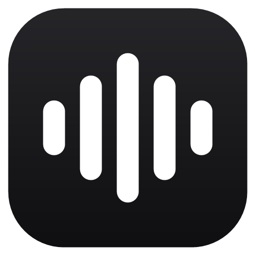

# Wispa

**Dictado por voz con IA para Windows.**
Habla con naturalidad y Wispa escribe por ti en cualquier aplicación: limpio, bien puntuado y listo para enviar.

### [⬇ Descargar para Windows](https://github.com/Reynellmds/wispa-releases/releases/latest)

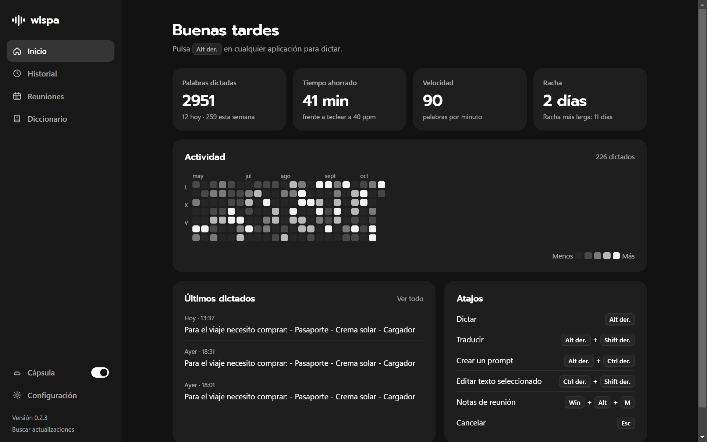

---

## ¿Qué es Wispa?

Wispa convierte tu voz en texto escrito en **cualquier aplicación de Windows**: correo, WhatsApp, Word, el navegador, tu editor de código… Pulsas una tecla, hablas y el texto aparece donde está el cursor.

No es un dictado literal: la IA **quita las muletillas, aplica tus correcciones** ("a las cinco, no, mejor a las seis"), **pone puntuación y da formato** a listas, correos, teléfonos o fechas. Además traduce mientras hablas, reescribe el texto que selecciones, convierte tus ideas en prompts para otras IA y toma notas de tus reuniones.

## Funciones

### 🎙️ Dictado inteligente
Pulsa **Alt derecho**, habla y vuelve a pulsar. El texto se pega en la aplicación que estés usando; si no hay ningún sitio donde escribir, se queda **copiado** para que lo pegues con Ctrl+V.

| Lo que dices | Lo que escribe Wispa |
|---|---|
| *"eh pues mañana quedamos a las nueve no espera a las nueve y media en la oficina"* | Mañana quedamos a las 9:30 en la oficina. |
| *"hola marta te confirmo que el pedido sale el lunes un saludo david"* | Hola, Marta:  Te confirmo que el pedido sale el lunes.  Un saludo, David |
| *"para el viaje necesito crema solar un cargador y sobre todo el pasaporte"* | Para el viaje necesito comprar: - Pasaporte - Crema solar - Cargador |

- Diccionario personal para que nombres, marcas y términos técnicos se escriban siempre bien.
- Botones **✕** (cancelar) y **✓** (terminar y pegar) en la propia burbuja, sin quitar el foco a tu aplicación.
- Funciona con teclados españoles: escribir `@`, `#` o `€` con AltGr no activa el dictado.

### ✏️ Editar el texto seleccionado
Selecciona cualquier texto, pulsa **Ctrl derecho + Shift derecho** y di cómo quieres cambiarlo: *"ponlo para redes sociales con emojis"*, *"hazlo más formal"*, *"tradúcelo al inglés"*, *"resúmelo en una frase"*. Wispa lo reescribe y sustituye la selección.

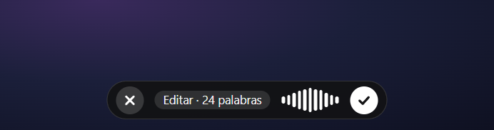

### 🌍 Traducción por voz
Con **Alt derecho + Shift derecho** hablas en tu idioma y Wispa escribe en otro. Elige hasta 3 idiomas de destino y cambia entre ellos tocando la etiqueta de la burbuja.

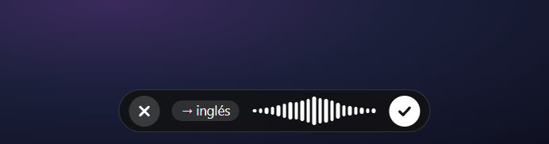

### ✨ Modo Prompt
Con **Alt derecho + Ctrl derecho** explicas lo que quieres a tu manera y Wispa lo convierte en un **prompt claro y completo** para otra IA. Detecta dónde lo vas a pegar y lo adapta:

- **Cursor o VS Code** → tarea, requisitos y criterios de aceptación.
- **ChatGPT o Claude** → rol, contexto y formato de respuesta.
- **Midjourney** → descripción visual compacta, en inglés.

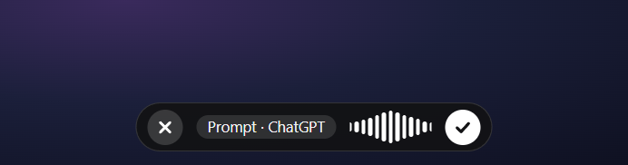

### 📝 Notas de reuniones
Pulsa **Win + Alt + M** (o ⏺ en la barra) al empezar una llamada de Zoom, Meet o Teams. Wispa graba tu micrófono y el audio de la llamada y, al terminar, redacta las notas: **resumen, puntos clave, decisiones, tareas con responsable y preguntas abiertas**.

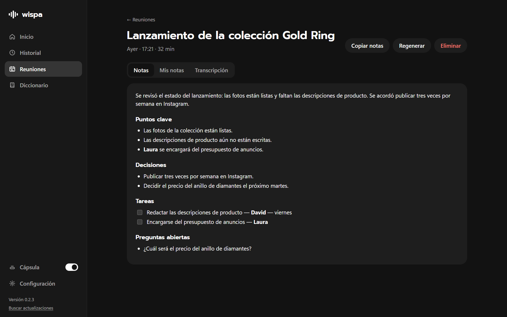

- Distingue lo que dices tú de lo que dicen los demás.
- Escribe **tus propias notas** durante la reunión; la IA las tiene en cuenta como lo más importante.
- Transcripción completa, copiar notas y regenerarlas cuando quieras.

### 📅 Calendario
Conecta Google Calendar u Outlook y verás tus próximas reuniones con **Unirse** y **Unirse + notas**. Wispa te avisa cuando empieza cada reunión y titula las notas con el nombre del evento y sus invitados.

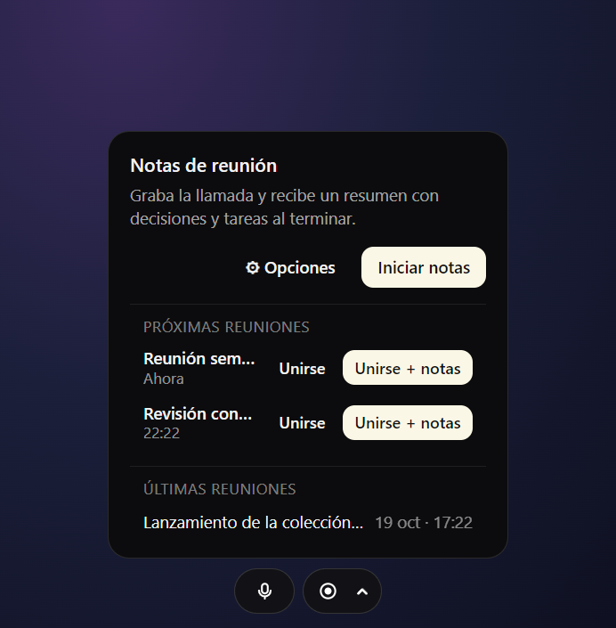

### 🫧 Barra flotante
Discreta y siempre a mano: en reposo es una cápsula fina sobre la barra de tareas que se despliega al pasar el ratón.

| En reposo | Al pasar el ratón | Menú (clic derecho) |
|:---:|:---:|:---:|
|  |  | 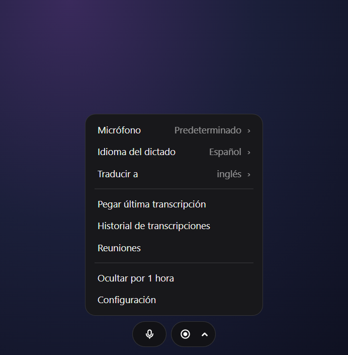 |

Desde el menú cambias de micrófono o de idioma, pegas la última transcripción o la ocultas durante una hora.

### 📊 Dashboard
Estadísticas de uso (palabras, tiempo ahorrado, velocidad, racha y mapa de actividad), historial completo, reuniones, diccionario y configuración, en modo claro u oscuro.

| Historial | Diccionario | Configuración |
|:---:|:---:|:---:|
| 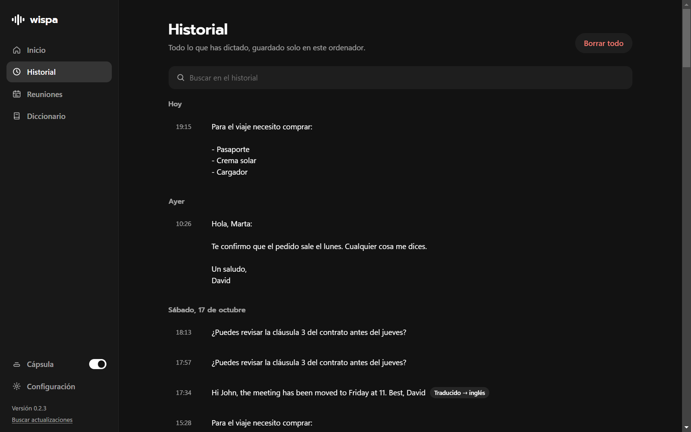 | 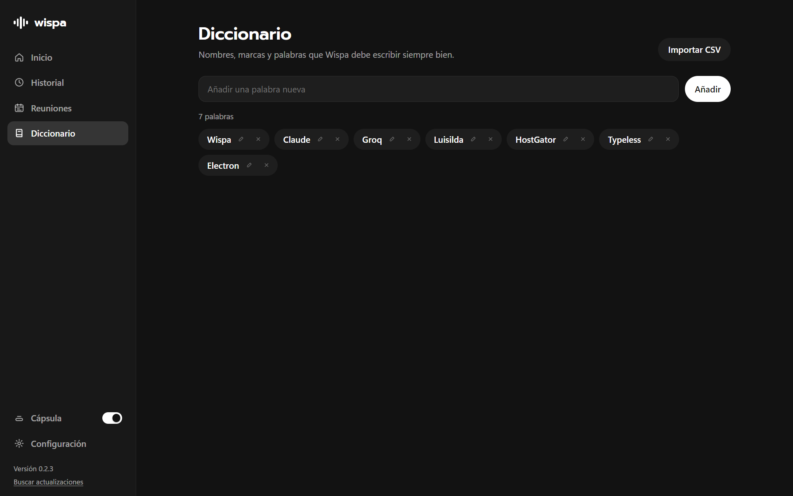 | 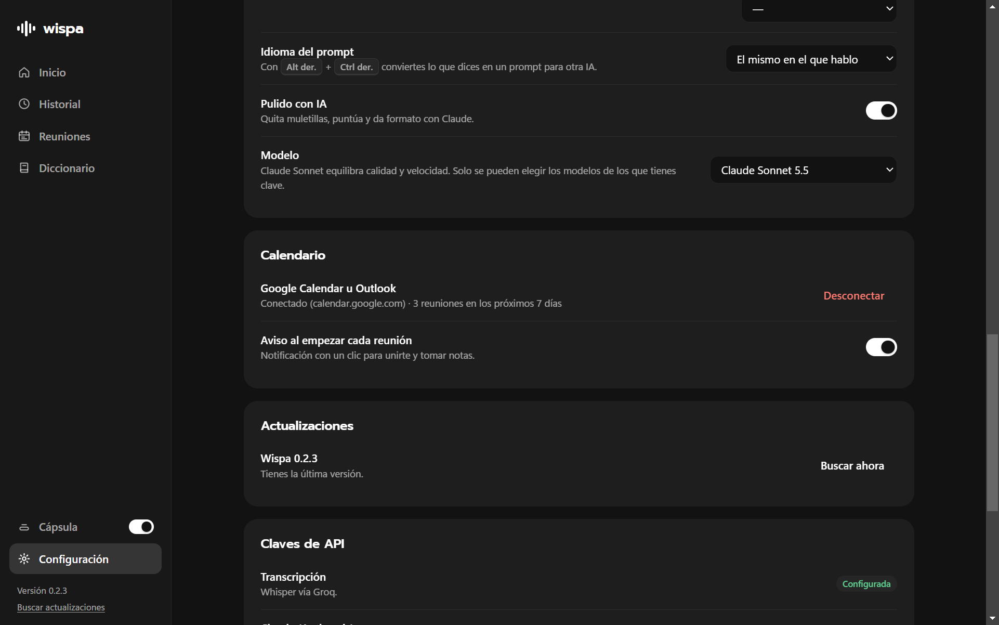 |

## Atajos de teclado

| Atajo | Acción |
|---|---|
| **Alt derecho** | Empezar / terminar el dictado |
| **Alt derecho + Shift derecho** | Dictar y traducir |
| **Alt derecho + Ctrl derecho** | Convertir lo que dices en un prompt |
| **Ctrl derecho + Shift derecho** | Editar el texto seleccionado |
| **Win + Alt + M** | Empezar / terminar las notas de una reunión |
| **Esc** | Cancelar |

Puedes cambiar los atajos en **Configuración → Atajos de teclado**, y activar ahí *Dictar manteniendo pulsado* si prefieres grabar mientras mantienes la tecla.

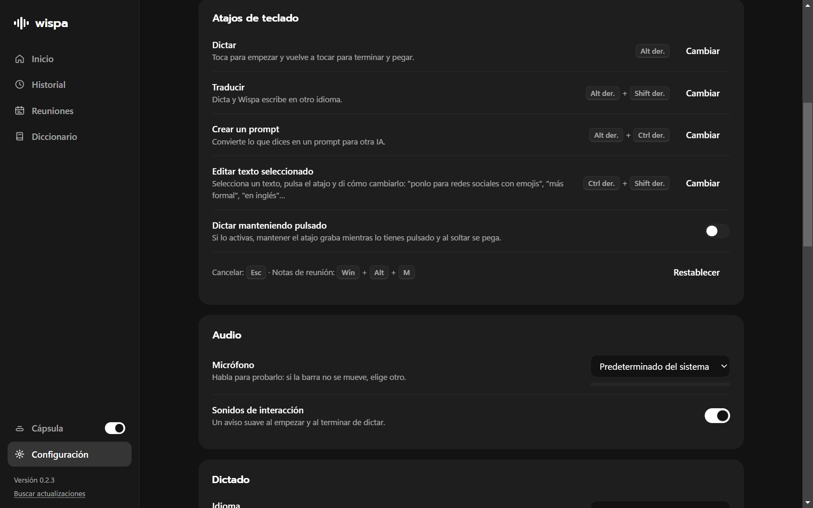

## Requisitos

- Windows 10 u 11 (64 bits) y un micrófono.
- Una **clave de API de Groq** (gratuita) para la transcripción → [console.groq.com/keys](https://console.groq.com/keys)
- Una **clave de API de Anthropic** (recomendada) para el pulido, la traducción, la edición, el modo Prompt y las notas de reuniones → [console.anthropic.com](https://console.anthropic.com/)
- O, en su lugar, una **clave de OpenAI** → [platform.openai.com/api-keys](https://platform.openai.com/api-keys). Con solo la de OpenAI, Wispa la usa también para transcribir.

> Sin clave de Anthropic ni de OpenAI, el dictado funciona igualmente, pero el texto se pega tal cual se transcribe.

## Instalación

1. Descarga **`Wispa-Setup-<versión>.exe`** desde la [última versión](https://github.com/Reynellmds/wispa-releases/releases/latest).
2. Ábrelo. Si Windows muestra *"Windows protegió tu PC"* (el instalador aún no está firmado), pulsa **Más información → Ejecutar de todas formas**.
3. Abre Wispa → **Configuración → Claves de API** y pega tus claves.
4. ¡Listo! Pulsa **Alt derecho** en cualquier aplicación y empieza a hablar.

## Privacidad

- Tu historial, reuniones, diccionario y claves se guardan **solo en tu ordenador** (`%APPDATA%\Wispa`).
- El audio se envía a **Groq** (u OpenAI) para transcribirlo y el texto a **Anthropic** (u OpenAI) para pulirlo, con tus propias claves. Wispa no tiene servidores propios que guarden tus datos.

## Actualizaciones

Wispa busca versiones nuevas al abrirse y cada pocas horas, las descarga en segundo plano y se actualiza al reiniciar. También puedes buscar a mano en **Configuración → Actualizaciones**.

## Preguntas frecuentes

<b>El atajo no hace nada o se activa otra aplicación</b>

Otras apps de dictado (Typeless, Wispr Flow…) usan los mismos atajos. Ciérralas, cambia sus atajos o cambia los de Wispa en Configuración → Atajos de teclado. Tampoco funcionan mientras tienes delante una ventana abierta como administrador.

<b>No aparece la barra flotante</b>

Actívala en el dashboard con el interruptor **Cápsula** (barra lateral) o desde el menú del icono de Wispa junto al reloj.

<b>Las notas de reunión no distinguen bien quién habla</b>

Usa auriculares: así el micrófono no capta el sonido de los altavoces y la separación entre tú y los demás es más limpia.

<b>¿Cómo conecto mi Google Calendar?</b>

En Google Calendar: ⚙ Configuración → tu calendario → *Integrar el calendario* → copia la **dirección secreta en formato iCal** y pégala en Wispa → Configuración → Calendario.

---

© 2026 Reynell · Todos los derechos reservados.

