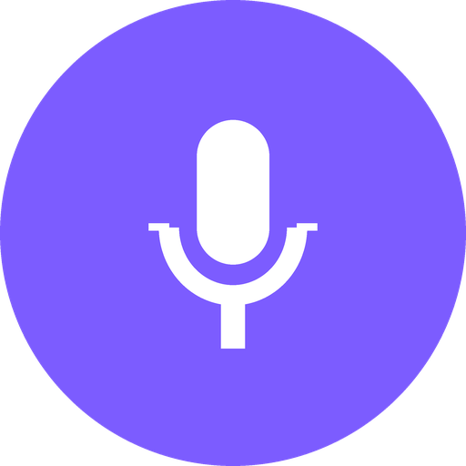
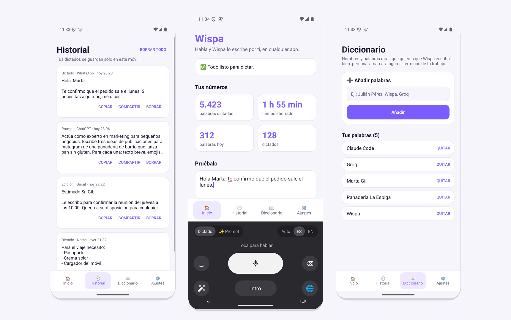
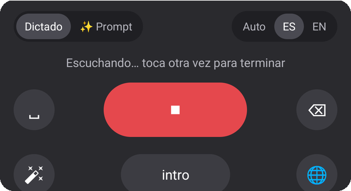
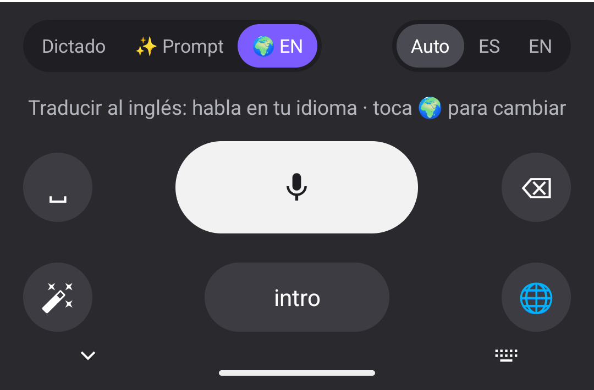
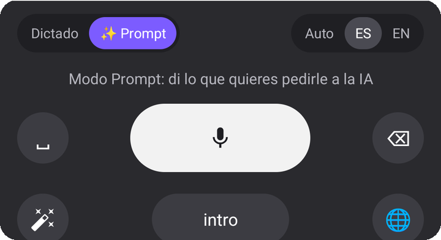
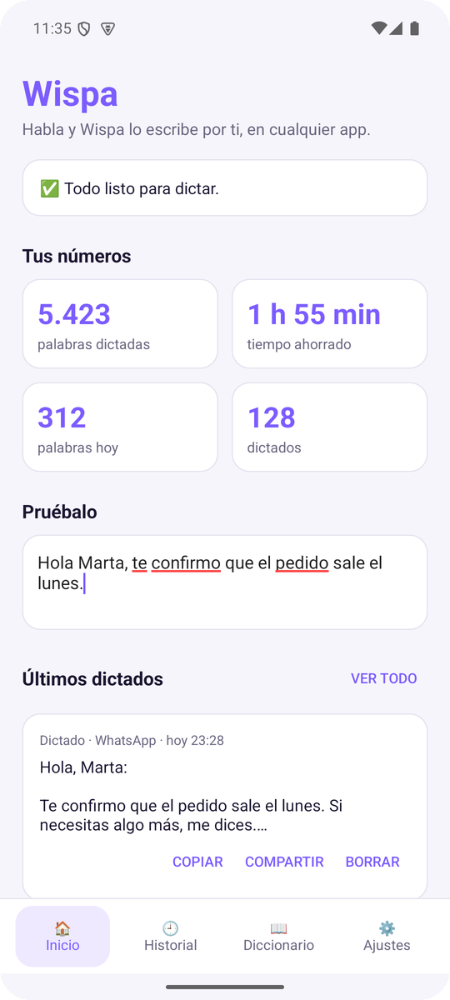
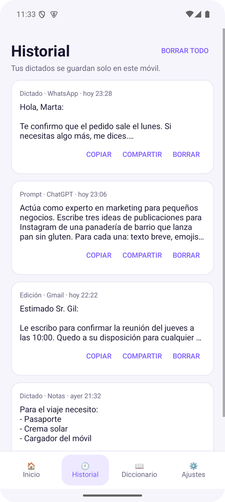
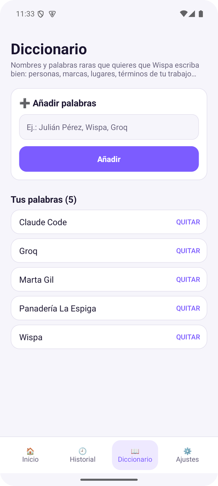
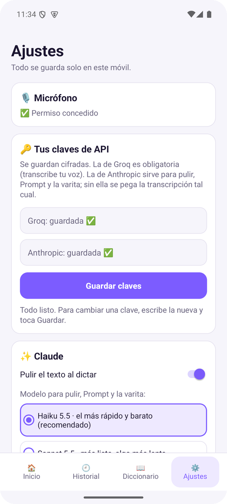
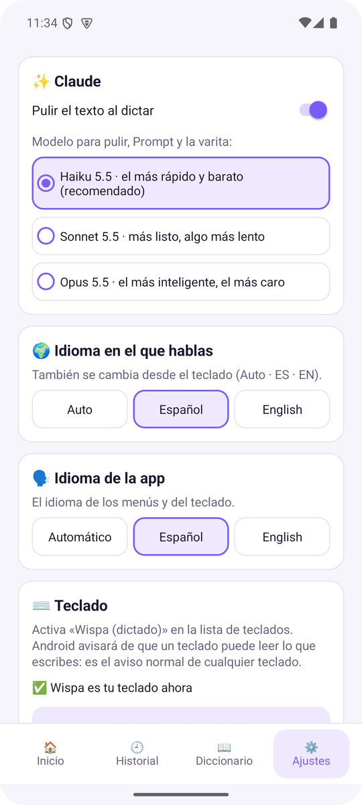

# Wispa para Android

**El teclado de dictado por voz con IA.**
Pulsa el micrófono, habla con naturalidad y Wispa escribe por ti en cualquier app: limpio, bien puntuado y listo para enviar.

### [⬇ Descargar para Android](https://github.com/Reynellmds/wispa-releases/releases/download/android/Wispa-movil.apk)

---

## ¿Qué es Wispa?

Wispa es un **teclado para Android** con un gran botón de micrófono. Funciona en **cualquier app**: WhatsApp, Gmail, Telegram, el navegador, Notas, ChatGPT… Tocas el micrófono, hablas y el texto aparece donde está el cursor.

No es un dictado literal: la IA **quita las muletillas, aplica tus correcciones** («a las nueve, no, mejor a las nueve y media»), **pone puntuación y da formato** a mensajes, listas, teléfonos o fechas. Además convierte tus ideas en prompts para otras IA y reescribe textos con la voz.

Es el hermano móvil de [Wispa para Windows](https://github.com/Reynellmds/wispa-releases).

## Funciones

### 🎙️ Dictado inteligente
Toca el **micrófono blanco**, habla y vuelve a tocarlo (se pone **rojo** mientras escucha). En unos segundos el texto aparece ya pulido en la app que estés usando.

| Lo que dices | Lo que escribe Wispa |
|---|---|
| *"eh pues mañana quedamos a las nueve no espera a las nueve y media en la oficina"* | Mañana quedamos a las 9:30 en la oficina. |
| *"hola marta te confirmo que el pedido sale el lunes un saludo david"* | Hola, Marta:  Te confirmo que el pedido sale el lunes.  Un saludo, David |
| *"para el viaje necesito crema solar un cargador y sobre todo el pasaporte"* | Para el viaje necesito: - Pasaporte - Crema solar - Cargador |

- Elige el idioma en el que hablas desde el propio teclado: **Auto**, **ES** o **EN**.
- **␣** espacio, **⌫** borrar (mantén pulsado para borrar una palabra), **intro** y **🌐** para volver a tu teclado normal.
- Mientras grabas ves un **cronómetro**, y **⌫** se convierte en **✕** para cancelar sin escribir nada.
- **Sonidos** suaves al empezar, terminar y cancelar (se pueden quitar en Ajustes).
- Si terminas sin haber hablado, no se escribe nada: Wispa avisa *«No se detectó voz»* en vez de inventar texto.
- Si no hay dónde escribir, lo dictado se queda **copiado** para que lo pegues.

### 🌍 Traducción por voz
Toca **🌍 EN** en el teclado, habla en tu idioma y Wispa escribe en otro. Elige hasta **3 idiomas** en Ajustes y pasa de uno a otro tocando 🌍 otra vez.

### ✨ Modo Prompt
Toca **✨ Prompt** en el teclado, explica lo que quieres a tu manera y Wispa lo convierte en un **prompt claro y completo** para otra IA. Sabe en qué app estás y lo adapta:

- **ChatGPT, Claude, Gemini, Copilot…** → rol, contexto y formato de respuesta.
- **Midjourney, Leonardo, Ideogram…** → descripción visual compacta, en inglés.
- **Replit, GitHub…** → tarea, requisitos y criterios de aceptación.

### 🪄 Varita mágica: edita con la voz
Selecciona un texto (o no selecciones nada para usar todo el campo), toca la **varita** y di qué quieres: *«hazlo más formal»*, *«ponlo para redes sociales con emojis»*, *«tradúcelo al inglés»*, *«resúmelo en una frase»*. Wispa lo reescribe y lo sustituye.

### 🏠 Tus números
La pantalla de inicio te dice si todo está listo y cuánto llevas dictado: **palabras, palabras de hoy, dictados, tiempo ahorrado** frente a escribir con el teclado, **palabras por minuto** y **días seguidos** dictando.

### 🕘 Historial
Todo lo que dictas queda guardado con la app donde lo hiciste y la hora. Puedes **copiarlo, compartirlo o borrarlo**, por si el texto no se pegó donde querías.

### 📖 Diccionario personal
Añade nombres y palabras raras (personas, marcas, lugares, términos de tu trabajo) para que Wispa **los escriba siempre bien**. Puedes añadir varias a la vez separadas por comas.

| Historial | Diccionario |
|:---:|:---:|
|  |  |

### ⚙️ Ajustes
- **Modelo de Claude:** Haiku 5.5 (el más rápido y barato, recomendado), Sonnet 5.5 u Opus 5.5 (el más inteligente).
- **Pulir el texto** activado o desactivado.
- **Idioma de la app:** automático, español o inglés.
- **Traducción:** hasta 3 idiomas de destino.
- **Sonidos** activados o desactivados.

| Claves y permisos | Claude e idiomas |
|:---:|:---:|
|  |  |

### 🔄 Se actualiza sola
Al abrir Wispa, si hay una versión nueva aparece **«Hay una versión nueva · Actualizar»**. Un toque y listo: se conservan tus claves, tu historial y tu diccionario.

## Cómo se usa

1. En cualquier app, toca un campo de texto.
2. Si sale tu teclado normal, cámbialo por Wispa con el botón de teclado (abajo a la derecha, ⌨) o con 🌐.
3. Toca el **micrófono**, habla y vuelve a tocarlo.
4. Para escribir a mano, toca **🌐** y vuelves a tu teclado de siempre.

## Requisitos

- Un móvil con **Android 8 o superior** y micrófono.
- Una **clave de API de Groq** (gratuita) para la transcripción → [console.groq.com/keys](https://console.groq.com/keys)
- Una **clave de API de Anthropic** (recomendada) para pulir el texto, el modo Prompt y la varita → [console.anthropic.com](https://console.anthropic.com/)

> Sin clave de Anthropic el dictado funciona igualmente, pero el texto se pega tal cual se transcribe.

## Instalación

Wispa todavía no está en Google Play: se instala desde un archivo APK.

1. En el móvil, abre **[Wispa-movil.apk](https://github.com/Reynellmds/wispa-releases/releases/download/android/Wispa-movil.apk)** y se descargará. No hace falta cuenta de GitHub.
2. Ábrelo desde la notificación de descarga. Android te pedirá permitir **instalar apps de orígenes desconocidos** desde el navegador: actívalo solo para él y vuelve atrás.
3. Toca **Instalar**. Si aparece *Play Protect*, elige **Instalar de todos modos** (avisa porque la app no viene de Google Play).
4. Abre **Wispa → Ajustes** y sigue los pasos:
   1. **Micrófono:** toca *Dar permiso al micrófono* → *Mientras se usa la app*.
   2. **Claves de API:** pega tus claves de Groq y Anthropic y toca *Guardar claves*.
   3. **Teclado:** toca *Abrir la lista de teclados*, activa **Wispa (dictado)** y acepta el aviso.
   4. Toca *Elegir Wispa como teclado*.
5. ¡Listo! Prueba en el cuadro *Pruébalo* de la pantalla de inicio.

## Privacidad

- Tus claves se guardan **cifradas solo en tu móvil** (Android Keystore). Tu historial, tu diccionario y tus estadísticas también se quedan **solo en el móvil**.
- El audio se envía a **Groq** para transcribirlo y el texto a **Anthropic** para pulirlo, con tus propias claves. Wispa no tiene servidores propios que guarden tus datos.
- El teclado solo escucha cuando tocas el micrófono, y deja de hacerlo si lo cierras mientras graba.

## Preguntas frecuentes

<b>Android dice que el teclado «podría recopilar todo lo que escribas»</b>

Es el aviso normal que Android muestra al activar **cualquier** teclado que no venga de fábrica. Wispa no lee lo que escribes con otros teclados: solo envía tu voz a Groq y el texto dictado a Anthropic.

<b>¿Cómo vuelvo a mi teclado normal?</b>

Toca **🌐** en el teclado Wispa. Para volver a Wispa, usa el botón de teclado que aparece abajo a la derecha (⌨) o el 🌐 de tu otro teclado.

<b>Dice «No se oyó nada»</b>

Comprueba que diste el permiso del micrófono (Wispa → Ajustes → Micrófono) y habla un poco más cerca. Si dictas frases muy cortas, elige **ES** en lugar de **Auto** en el teclado: así Whisper no tiene que adivinar el idioma.

<b>Escribe mal un nombre o una palabra</b>

Añádela en **📖 Diccionario** tal y como quieres que aparezca. Wispa se lo pasa a la transcripción y a Claude para que la escriban bien.

<b>¿Cuánto cuesta?</b>

La app es gratis. Pagas solo lo que uses de tus claves: Groq tiene un plan gratuito y, con Haiku 5.5, pulir un mensaje cuesta una fracción de céntimo.

<b>¿Hay versión para iPhone?</b>

Todavía no. Está prevista: en iPhone los teclados no pueden usar el micrófono, así que funcionará abriendo un momento la app Wispa para escuchar.

---

© 2026 Reynell · Todos los derechos reservados.

